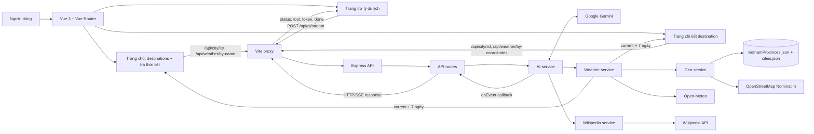

# BÁO CÁO TỔNG QUAN DỰ ÁN

## 1. Thông tin chung

- **Tên dự án:** Trợ lý du lịch (tên package hiện tại: `my-asm`).
- **Loại ứng dụng:** Ứng dụng web gồm giao diện người dùng và máy chủ API.
- **Tình trạng hiện tại:** Đây là một MVP đang hoạt động, không còn ở trạng thái base trống hoặc template rỗng. Các màn hình chính và API đã được triển khai và kiểm tra chạy.
- **Mục tiêu:** Hỗ trợ người dùng tra cứu thời tiết và tìm hiểu thông tin về địa điểm bằng câu hỏi tiếng Việt tự nhiên.
- **Đối tượng sử dụng:** Người đang tìm thông tin cơ bản để tham khảo khi lên kế hoạch du lịch.

## 2. Ý tưởng và vấn đề cần giải quyết

Khi chuẩn bị đi du lịch, người dùng thường phải tìm thời tiết ở một dịch vụ, tra cứu địa điểm ở dịch vụ khác rồi tự tổng hợp thông tin. Dự án xây dựng một giao diện hỏi đáp tập trung: người dùng nhập câu hỏi, trợ lý AI xác định dữ liệu cần lấy, gọi dịch vụ phù hợp và trả lời bằng tiếng Việt. Kết quả thời tiết có thể được hiển thị thành các thẻ riêng để dễ theo dõi.

Ví dụ câu hỏi: “Dự báo thời tiết 3 ngày ở Hà Nội và giới thiệu về Hà Nội”.

## 3. Giải pháp và chức năng

### Chức năng đã có trong mã nguồn

- Trang chủ Vue có banner destination tự chuyển mỗi 3 giây, tìm kiếm danh sách và badge gợi ý tra cứu thời tiết theo tên.
- Trang chi tiết theo `/destinations/:id` hiển thị thông tin destination, gallery ảnh và các phần tham quan, ẩm thực, lưu trú, di chuyển, mẹo du lịch.
- Trang chủ và detail dùng chung `WeatherOverview`: thời tiết hiện tại, thơ thời tiết từ trường `meme`, các chỉ số cơ bản và dự báo 7 ngày. Trang chủ tra theo tên; detail tra theo tọa độ trong JSON.
- Trợ lý Gemini nhận câu hỏi qua SSE, có chip câu hỏi demo, stream Markdown đã sanitize và hiển thị kết quả tool.
- Gemini có tool thời tiết hiện tại, dự báo tối đa 7 ngày và Wikipedia summary. System prompt quy định chỉ gọi tool thời tiết khi câu hỏi hỏi rõ về thời tiết.
- Wikipedia summary có thumbnail tùy chọn; nội dung summary dạng chuỗi vẫn là phần gửi lại cho Gemini.
- Dữ liệu tọa độ offline đến từ `vietnamProvinces.json` và các destination trong `cities.json`; geocoder Nominatim là fallback.
- Máy chủ có cache RAM và Winston logging.

### Phạm vi cần lưu ý

`cities.json` hiện là dữ liệu tĩnh và ảnh được tải từ các host bên ngoài. `Leaflet` có trong dependencies nhưng chưa được dùng để hiển thị bản đồ. Tin tức chưa phải luồng chức năng hoàn chỉnh, do đó báo cáo không xem bản đồ tương tác hoặc tin tức là tính năng đã bàn giao.

## 4. Công nghệ và thư viện npm

| Thư viện/công nghệ | Vai trò và lý do chọn | Ưu điểm | Hạn chế |
| --- | --- | --- | --- |
| **Vue 3** (`vue`) | Xây dựng giao diện theo component; phù hợp với màn hình trợ lý có trạng thái tải, lỗi và kết quả cập nhật liên tục. | Cấu trúc component rõ; hệ thống `ref` và `computed` thuận tiện cho giao diện phản ứng. | Cần nắm cách tổ chức component và trạng thái; hệ sinh thái khác React nên việc tuyển người/học liệu có thể khác tùy nhóm. |
| **Vue Router** (`vue-router`) | Điều hướng giữa trang danh sách, chi tiết destination và trợ lý. | Route URL rõ ràng, hỗ trợ điều hướng client-side và deep link. | Cần cấu hình history fallback khi triển khai production. |
| **Vite** (`vite`) | Chạy máy chủ phát triển và đóng gói client; thời gian khởi động nhanh, cấu hình gọn. | Phản hồi nhanh khi phát triển; hỗ trợ build frontend riêng. | Cần cấu hình proxy/build phù hợp khi triển khai cùng backend. |
| **@vitejs/plugin-vue** | Kết nối cú pháp Single-File Component của Vue với Vite. | Cho phép viết template, logic và style trong file `.vue`; tích hợp trực tiếp với Vite. | Gắn với Vue và Vite; không cần thiết nếu chuyển framework hoặc bundler khác. |
| **Marked** (`marked`) | Chuyển Markdown do Gemini trả về thành HTML cho giao diện. | Hỗ trợ Markdown phổ biến, GFM và bảng. | HTML đầu ra cần sanitize trước khi render. |
| **DOMPurify** (`dompurify`) | Làm sạch HTML Markdown trước khi Vue đưa vào DOM. | Giảm nguy cơ chèn HTML nguy hiểm từ nội dung model. | Cần giữ cấu hình và phiên bản cập nhật. |
| **Express** (`express`) | Tạo HTTP API, nhóm route và middleware cho backend. | Nhẹ, dễ chia route và service; phù hợp làm lớp trung gian bảo vệ API key. | Ít quy ước bắt buộc; dự án phải tự tổ chức cấu trúc, kiểm tra đầu vào và bảo mật. |
| **CORS** (`cors`) | Thêm CORS headers cho các origin frontend được khai báo trong `CLIENT_ORIGINS`, bao gồm preflight request. | Cho phép frontend khác origin gọi API theo allowlist. | Không phải cơ chế xác thực và không chặn request từ `curl` hoặc server khác; chỉ kiểm soát trình duyệt có được đọc response hay không. |
| **Axios** (`axios`) | Gửi HTTP request từ backend tới các API dữ liệu bên ngoài; client cũng có sẵn một HTTP client dùng chung. | API gọi HTTP nhất quán, hỗ trợ cấu hình timeout và query parameters. | Là dependency bổ sung trong khi nền tảng trình duyệt/Node.js có Fetch; dự án cần tránh duy trì hai cách gọi HTTP không cần thiết. |
| **@google/genai** | Gọi Gemini, nhận phản hồi dạng luồng và khai báo các công cụ để mô hình yêu cầu lấy dữ liệu. | Hỗ trợ tích hợp Gemini và luồng phản hồi; phù hợp với chức năng hỏi đáp có sử dụng tool. | Phụ thuộc mạng, API key, hạn mức và chi phí/dịch vụ của bên thứ ba; mô hình có thể lỗi hoặc thay đổi hành vi. |
| **Leaflet** (`leaflet`) | Thư viện bản đồ 2D đã được thêm vào client cho hướng mở rộng bản đồ du lịch. | Nhẹ, mã nguồn mở, có hệ sinh thái tile/lớp dữ liệu phong phú. | Chưa được giao diện hiện tại sử dụng; cần thêm tile và dữ liệu bản đồ, có thể chịu điều khoản/hạn mức từ nhà cung cấp tile. |
| **Winston** (`winston`) | Ghi log ứng dụng ra console và file. | Có nhiều mức log và cách cấu hình đầu ra; thuận tiện khi điều tra lỗi trên backend. | Cần cấu hình và quản lý file log; có thể tăng dung lượng lưu trữ nếu không xoay/xóa file cũ. |
| **winston-daily-rotate-file** | Tạo file log theo ngày và giới hạn thời gian lưu log. | Dễ chia log theo ngày; cấu hình hiện tại giữ file tối đa 14 ngày. | Tạo thêm file và yêu cầu quản lý dung lượng/đường dẫn log. |
| **concurrently** | Chạy lệnh phát triển client và server cùng lúc từ package ở thư mục gốc. | Một lệnh khởi động cả hai tiến trình, thuận tiện cho phát triển. | Chỉ hỗ trợ điều phối tiến trình phát triển; không thay thế công cụ vận hành/giám sát production. |

### Công cụ nền tảng và dịch vụ dữ liệu

- **Node.js:** chạy backend; package server khai báo yêu cầu Node.js từ phiên bản 20 trở lên. Dự án dùng chế độ `--watch`, nạp biến môi trường bằng `--env-file` và test runner tích hợp `node:test`, không cần cài riêng các gói npm cho các chức năng này.
- **Open-Meteo:** nguồn dữ liệu thời tiết, được gọi qua HTTP; không cần thư viện npm riêng.
- **OpenStreetMap Nominatim:** tìm tọa độ cho địa điểm chưa có trong dữ liệu offline. Dự án đặt `countrycodes=vn`; cần tuân thủ giới hạn truy cập và cung cấp User-Agent phù hợp.
- **Wikipedia API:** nguồn nội dung địa điểm, hỗ trợ endpoint tiếng Việt và dự phòng tiếng Anh.
- **News API:** được README đề cập như hướng tích hợp, nhưng phần route/service hiện chưa triển khai hoàn chỉnh.
- **Mermaid:** các sơ đồ trong báo cáo dùng fenced code block `mermaid`, không phải dependency/runtime feature của ứng dụng. VS Code Markdown Preview render trực tiếp các sơ đồ này; mở Preview bằng `Ctrl+Shift+V` hoặc Preview to the Side bằng `Ctrl+K V`.

Các package npm trên được xác định từ dependencies/devDependencies khai báo ở package root, `client/package.json` và `server/package.json`. `my-asm` trong hai package con là liên kết nội bộ tới package ở thư mục gốc, không phải thư viện bên thứ ba.

## 5. Kiến trúc tổng thể

Ứng dụng tách frontend và backend. Trình duyệt gửi request đến đường dẫn `/api`; máy chủ Vite chuyển tiếp đường dẫn này sang Express trong môi trường phát triển. Express kiểm tra request, gọi route tương ứng; route sử dụng service để truy xuất nguồn dữ liệu. API key Gemini nằm ở phía server thông qua biến môi trường, không được gửi từ giao diện trình duyệt.



## 6. Sơ đồ luồng xử lý chính

```mermaid
sequenceDiagram
    actor User as Người dùng
    participant UI as Vue - TravelAssistant
    participant Proxy as Vite proxy
    participant API as Express - /api/ai/stream
    participant Service as AI service
    participant Gemini as Gemini
    participant Data as Weather / Geo / Wikipedia services

    User->>UI: Nhập câu hỏi và gửi
    UI->>Proxy: POST /api/ai/stream { prompt }
    Proxy->>API: Chuyển tiếp request
    API->>API: Kiểm tra prompt, mở kết nối SSE
    API-->>UI: Sự kiện status
    API->>Service: askTravelAssistantStream(prompt, callback, signal)
    API-->>UI: SSE status ban đầu
    loop Tối đa 4 vòng thực thi tool (step 0-3)
        Service-->>API: Callback status của lượt
        API-->>UI: SSE status
        Service->>Gemini: Prompt/lịch sử hội thoại + khai báo tools
        Gemini-->>Service: Văn bản hoặc yêu cầu functionCall
        Service-->>API: Callback token nếu có
        API-->>UI: SSE token
        opt Gemini yêu cầu một hoặc nhiều tool
            Service->>Data: Chạy tool được yêu cầu (có thể song song)
            Data-->>Service: Kết quả hoặc lỗi
            Service-->>API: Callback tool_start và tool_result/tool_error
            API-->>UI: SSE tool events
            Service->>Gemini: Lịch sử hội thoại + functionResponse
        end
    end
    opt Lượt tổng hợp cuối (step 4, không khai báo tools)
        Service-->>API: Callback status tổng hợp
        API-->>UI: SSE status
        Service->>Gemini: Lịch sử hội thoại, không có tools
        Gemini-->>Service: Câu trả lời cuối hoặc yêu cầu tool vượt giới hạn
    end
    Service-->>API: Kết quả cuối hoặc câu fallback
    API-->>UI: SSE done; route đóng response
    UI-->>User: Hiển thị câu trả lời và dữ liệu thời tiết
```

Luồng có thể kết thúc sớm nếu Gemini trả lời mà không yêu cầu tool. Sau tối đa bốn vòng thực thi tool, service gọi Gemini thêm ở `step = 4` nhưng không khai báo tools; nếu model vẫn yêu cầu tool, service trả fallback. Các event do AI service phát đều được Express route chuyển thành frame SSE, không đi thẳng từ service tới Vue.

## 7. Ví dụ sử dụng thực tế

Người dùng gửi câu hỏi:

> Dự báo thời tiết 3 ngày ở Hà Nội và giới thiệu về Hà Nội.

Luồng xử lý dự kiến:

1. Giao diện gửi nội dung câu hỏi tới `POST /api/ai/stream`.
2. Gemini phân tích yêu cầu và có thể yêu cầu công cụ dự báo thời tiết cùng công cụ tóm tắt Wikipedia.
3. Dịch vụ tìm tọa độ Hà Nội trong dữ liệu tỉnh/thành; sau đó lấy dự báo 3 ngày từ Open-Meteo. Wikipedia cung cấp phần giới thiệu địa điểm.
4. Backend gửi dữ liệu công cụ cho Gemini để tổng hợp câu trả lời. Trong lúc chờ, giao diện nhận trạng thái và các phần văn bản qua SSE.
5. Giao diện hiển thị phần giới thiệu và thẻ dự báo ngày, nhiệt độ cao/thấp, điều kiện thời tiết.

Việc Gemini chọn tool là quyết định ở thời điểm chạy; nếu một nguồn dữ liệu lỗi thì kết quả thực tế có thể thiếu phần tương ứng. Ví dụ này mô tả luồng, không phải dự báo thời tiết trực tiếp tại thời điểm viết báo cáo.

## 8. API tiêu biểu

| Phương thức | Đường dẫn | Chức năng |
| --- | --- | --- |
| `GET` | `/api/health` | Kiểm tra máy chủ đang hoạt động. |
| `GET` | `/api/city/list` | Danh sách destinations từ `cities.json`. |
| `GET` | `/api/city/:id` | Chi tiết một destination. |
| `GET` | `/api/weather/by-name/:city` | Thời tiết hiện tại và dự báo 7 ngày theo tên. |
| `GET` | `/api/weather/by-coordinates?lat=...&lon=...` | Thời tiết hiện tại và 7 ngày theo tọa độ. |
| `POST` | `/api/ai` | Gửi câu hỏi và nhận kết quả JSON. |
| `POST` | `/api/ai/stream` | Gửi câu hỏi và nhận sự kiện phản hồi theo luồng SSE. |
| `GET` | `/api/weather/provinces` | Lấy danh sách tỉnh/thành có trong tệp dữ liệu. |
| `GET` | `/api/weather/current/:city` | Lấy thời tiết hiện tại theo tên thành phố. |
| `GET` | `/api/wiki/summary/:title` | Lấy summary cùng thumbnail tùy chọn. |
| `GET` | `/api/wiki/article/:title` | Lấy nội dung bài Wikipedia. |

Các endpoint `/api/news` chưa phải chức năng hoàn chỉnh.

## 9. Ưu điểm, hạn chế và hướng phát triển

### Ưu điểm

- Câu hỏi tự nhiên giúp gom nhiều bước tra cứu vào một thao tác.
- Tách frontend, route và service giúp phân định phần giao diện, API và tích hợp dữ liệu.
- Dùng dữ liệu offline cho tỉnh/thành Việt Nam giúp giảm request địa lý và tăng độ ổn định cho các địa điểm có sẵn.
- Cache giảm việc gọi lặp tới Gemini hoặc API dữ liệu trong thời gian hiệu lực.
- SSE cho phép người dùng thấy trạng thái và nội dung dần xuất hiện thay vì chờ toàn bộ câu trả lời.

### Hạn chế

- Trợ lý cần API key Gemini và kết nối các dịch vụ bên ngoài; khi dịch vụ lỗi hoặc vượt hạn mức, trải nghiệm bị ảnh hưởng.
- Cache hiện lưu trong RAM, bị xóa khi khởi động lại và không được chia sẻ giữa nhiều tiến trình server.
- Ảnh destination đến từ URL bên ngoài; nếu host chặn hotlink hoặc ảnh bị gỡ thì giao diện dùng fallback.
- Dữ liệu tọa độ offline có phạm vi hữu hạn; địa điểm ngoài hai file JSON phụ thuộc Nominatim và chính sách sử dụng của dịch vụ.
- News API và trải nghiệm bản đồ chưa hoàn chỉnh; báo cáo không xem chúng là tính năng đã bàn giao.
- Chưa thấy cơ sở dữ liệu ứng dụng trong các package/cấu trúc đang khảo sát; hiện các nguồn chính đến từ API ngoài và JSON tĩnh.

### Hướng phát triển

1. Hoàn thiện màn hình bản đồ Leaflet, đánh dấu địa điểm và kết nối với dữ liệu tọa độ/thời tiết.
2. Hoàn thiện News API, bao gồm cấu hình API key, kiểm tra lỗi và giao diện hiển thị bài viết.
3. Bổ sung kiểm soát tốc độ gọi API, timeout, retry hợp lý và thông báo lỗi nhất quán.
4. Cân nhắc cache dùng chung nếu triển khai nhiều instance; bổ sung lưu lịch sử/yêu thích nếu cần đồng bộ giữa thiết bị.
5. Bổ sung kiểm thử tích hợp cho API ngoài bằng mock và kiểm thử luồng SSE từ đầu cuối.

## 10. Cách chạy dự án để trình bày

Yêu cầu: Node.js 20 trở lên và npm. Cài dependencies từ thư mục gốc:

```bash
npm run install:all
```

Tạo `server/.env` từ `server/.env.example`, thêm `GEMINI_API_KEY`, sau đó chạy frontend và backend:

```bash
npm run dev
```

Mặc định giao diện phát triển ở `http://localhost:5173`, backend ở `http://localhost:3000`. Có thể kiểm tra backend tại `http://localhost:3000/api/health`.

## 11. Kết luận

Dự án hiện có trải nghiệm khám phá destination, trang chi tiết, tra thời tiết hiện tại/dự báo 7 ngày và trợ lý tiếng Việt dùng Gemini, weather service và Wikipedia. Điểm đáng chú ý là cùng một `WeatherOverview` được dùng ở trang chủ và detail, detail dùng tọa độ trong dữ liệu để tra chính xác, còn AI chỉ gọi tool thời tiết khi có ý định thời tiết rõ ràng. Bản đồ tương tác và tin tức vẫn là các phần cần tiếp tục phát triển.