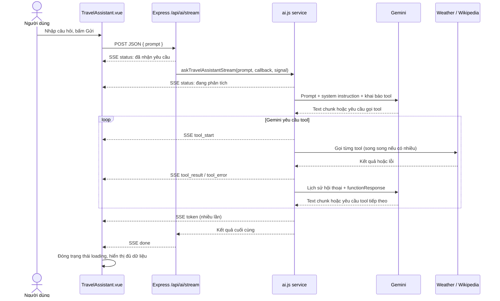

# Cơ chế Backend - Frontend Streaming trong chế độ Trợ lý

Tài liệu này giải thích luồng đang chạy trong dự án: từ lúc người dùng bấm **Gửi câu hỏi**, qua Vue, Express, Gemini và các tool thời tiết/Wikipedia, cho đến khi kết quả được hiển thị. Các đường dẫn bên dưới tính từ thư mục gốc repository.

## 1. Tóm tắt nhanh

Chế độ Trợ lý dùng một request HTTP `POST` duy nhất tới `/api/ai/stream`. Kết nối được giữ mở. Thay vì chờ server xử lý xong rồi trả một cục JSON, backend gửi nhiều thông điệp nhỏ theo định dạng **SSE** (*Server-Sent Events*). Frontend đọc từng thông điệp và cập nhật giao diện ngay.



Các điểm chính:

- Đây là **stream sự kiện của toàn bộ quá trình**, không chỉ stream chữ: status, gọi tool, dữ liệu tool, token câu trả lời và kết thúc đều được gửi.
- Kết nối là một chiều từ server về client trong khi request `POST` vẫn đang mở. SSE không bắt buộc phải dùng `EventSource`; ở đây frontend dùng `fetch()` vì cần gửi JSON body.
- Gemini có thể phải gọi tool trước khi có câu trả lời cuối. Vì vậy giao diện có thể hiện tiến độ và dữ liệu thời tiết/Wikipedia trước khi câu trả lời văn bản hoàn tất.

## 2. Những file điều khiển luồng

| Phần | File | Trách nhiệm |
| --- | --- | --- |
| Giao diện và bộ đọc SSE | `client/src/components/TravelAssistant.vue` | Gửi prompt, đọc byte stream, phân tích SSE, cập nhật trạng thái Vue và render kết quả. |
| Tạo URL API | `client/src/api/http.js` | Tạo URL dựa trên `VITE_API_BASE_URL` hoặc base path của ứng dụng. |
| Đăng ký route | `server/src/routes/index.js` | Gắn router AI tại `/api/ai`. |
| HTTP/SSE endpoint | `server/src/routes/ai.js` | Kiểm tra prompt, đặt header SSE, ghi event và đóng response. |
| Điều phối Gemini và tool | `server/src/services/ai.js` | Stream model, chạy tool, gửi kết quả tool lại cho Gemini và tổng hợp response cuối. |

## 3. Luồng từ nút Gửi ở frontend

Trong `TravelAssistant.vue`, hàm `askAssistant()` thực hiện các bước:

1. Nếu prompt rỗng, hiện lỗi tại giao diện và không gọi API.
2. Xóa câu trả lời, lỗi, trạng thái tool và dữ liệu tool của lượt trước; bật `loading`.
3. Gọi `fetch(apiUrl('/ai/stream'), { method: 'POST', ... })`, gửi JSON `{ "prompt": "..." }`.
4. Nếu HTTP status không thành công, đọc JSON lỗi (thường là lỗi kiểm tra request như thiếu prompt) và không cố phân tích body như SSE.
5. Nếu request thành công, chuyển `response` cho `readEventStream()` để đọc liên tục.
6. Khi đọc xong hoặc gặp lỗi mạng, tắt `loading` trong `finally`.

`apiUrl()` trả về đường dẫn API theo cấu hình client. Ví dụ khi mặc định base path là `/`, URL cuối là `/api/ai/stream`.

Frontend hiện **không tạo `AbortController` và không có thao tác hủy**. Nút gửi bị khóa khi `loading` đang bật. Nếu trình duyệt/người dùng đóng kết nối, backend có cơ chế nhận biết và truyền tín hiệu hủy xuống Gemini (xem mục 8).

## 4. SSE là gì trong luồng này?

Backend gửi response với các header chính:

```http
Content-Type: text/event-stream; charset=utf-8
Cache-Control: no-cache, no-transform
Connection: keep-alive
X-Accel-Buffering: no
```

Mỗi sự kiện là một frame văn bản, kết thúc bằng **một dòng trống**. Cấu trúc đơn giản mà server sử dụng:

```text
event: token
data: {"type":"token","text":"Xin chào"}

```

- `event:` là tên loại sự kiện để frontend biết cần làm gì.
- `data:` là JSON payload của sự kiện.
- Dòng trống báo hiệu frame đã hoàn chỉnh và có thể xử lý.
- Server gọi `res.write()` cho từng frame; `res.end()` chỉ được gọi khi quy trình kết thúc.

Một lần đọc từ mạng **không đảm bảo** tương ứng với một frame. Một lần đọc có thể chứa nửa frame, một frame, hoặc nhiều frame. Vì thế client phải gom dữ liệu vào buffer và chỉ parse phần đã có dấu phân cách dòng trống.

## 5. Những loại event và ý nghĩa của chúng

| Event | Payload thường gặp | Tác dụng trên giao diện |
| --- | --- | --- |
| `status` | `{ "message": "Đang phân tích yêu cầu..." }` | Cập nhật dòng tiến độ. Backend gửi một status ban đầu khi nhận request, sau đó service gửi status theo từng lượt Gemini. |
| `tool_start` | `{ "tool": "getWikiSummary", "args": { "title": "Hà Nội" } }` | Báo một tool sắp chạy; giao diện đổi trạng thái thành “Đang lấy thông tin địa điểm...”. |
| `tool_result` | `{ "result": { "tool": "getWikiSummary", "args": { ... }, "data": { ... } } }` | Thêm kết quả vào danh sách tool; computed properties phân loại để hiện thẻ thời tiết hoặc ngữ cảnh Wikipedia. |
| `tool_error` | `{ "error": { "tool": "...", "error": "..." } }` | Ghi nhận lỗi tool và cho biết phần dữ liệu nào không lấy được. Các tool khác vẫn có thể chạy/thành công. |
| `token` | `{ "text": "Một phần câu trả lời" }` | Nối phần chữ mới vào `answer`, nên câu trả lời có thể xuất hiện dần. |
| `reset` | Không có dữ liệu đáng kể | Xóa chữ tạm đã nhận trong lượt Gemini vừa yêu cầu tool, tránh trộn phần chữ trước tool với câu trả lời tổng hợp sau tool. |
| `error` | `{ "message": "AI chưa thể xử lý..." }` | Hiện lỗi/fallback. Lỗi này vẫn có thể nằm trong một response SSE HTTP 200; đó không phải HTTP status lỗi. |
| `done` | `{ "answer": "...", "usedTools": [...], "toolResults": [...], "toolErrors": [...] }` | Đánh dấu hoàn tất, đồng bộ kết quả cuối và hiện trạng thái “Hoàn tất”. |

Payload do service gửi thường có trường `type` bên trong JSON, do route chuyển nguyên object event làm `data`. Event `status` đầu tiên được route tự gửi chỉ có trường `message`. Client dựa vào tên `event:` để phân luồng; không cần `type` trong JSON.

`done` là bản tổng kết cuối cùng. `tool_result` hữu ích để hiện dữ liệu sớm khi stream đang chạy; khi nhận `done`, frontend lấy `usedTools` và đồng bộ `toolResults`/`toolErrors` theo kết quả cuối.

## 6. Cách frontend đọc và hiển thị từng frame

Hàm `readEventStream(response)` làm việc ở mức byte/text:

1. Lấy reader từ `response.body.getReader()`.
2. Dùng `TextDecoder` giải mã UTF-8 theo từng phần. Tùy chọn `stream: true` giữ lại byte chưa đủ của một ký tự, tránh lỗi chữ tiếng Việt nếu ký tự bị chia giữa hai lần đọc.
3. Nối text mới vào `buffer`.
4. Tìm dấu phân cách `\n\n`; chỉ frame hoàn chỉnh mới được đưa vào `dispatchFrame()`.
5. Tách `event:` và `data:`. Các dòng `data:` trong cùng frame được ghép rồi parse thành JSON.
6. Gọi `handleStreamEvent(event, data)` để cập nhật reactive state trong Vue.
7. Khi stream đóng, xử lý nốt frame còn dư nếu có.

`handleStreamEvent()` cập nhật các state chính:

- `statusMessage`: tiến độ hiện tại.
- `answer`: các token văn bản đã nhận.
- `toolResults`: dữ liệu gốc của thời tiết/Wikipedia để render riêng.
- `toolSummary`: danh sách tool server xác nhận đã chạy thành công.
- `error`: lỗi chung hoặc lỗi tool.
- `loading`: được tắt khi hàm gửi request kết thúc.

Markdown của câu trả lời được chuyển thành HTML bằng `marked`, sau đó làm sạch bằng `DOMPurify` trước khi hiển thị. Wikipedia và thời tiết không phụ thuộc vào việc trích xuất nội dung từ câu trả lời: chúng được render trực tiếp từ `toolResults`.

Trong lúc phát triển, component còn ghi raw chunk, event đã parse và snapshot kết thúc vào console để thuận tiện kiểm tra luồng. Đây là log debug của frontend, không phải một phần giao thức bắt buộc.

## 7. Backend gọi Gemini và tool như thế nào?

### 7.1 Route mở kết nối SSE

`POST /api/ai/stream` được gắn qua router `/api` rồi `/ai`. Route kiểm tra prompt trước. Prompt rỗng trả HTTP `400` dạng JSON, trước khi mở SSE.

Với prompt hợp lệ, route:

1. Tạo `AbortController` để có thể hủy lời gọi model khi kết nối bị ngắt.
2. Đặt header SSE và gọi `flushHeaders()` để gửi header ngay, không phải đợi Gemini xong.
3. Định nghĩa `sendEvent(type, data)`, serialize payload thành JSON và ghi frame vào response.
4. Gửi event `status` ban đầu: đã nhận yêu cầu, đang kết nối trợ lý.
5. Gọi `askTravelAssistantStream(prompt, callback, signal)`; mỗi callback từ service trở thành một SSE event.
6. Khi service trả kết quả, gửi `done`, rồi đóng response bằng `res.end()`.

### 7.2 Service stream Gemini

`askTravelAssistantStream()` gọi `chatWithTools()` trực tiếp, không dùng cache. Service thường không thể phát lại một response cache cũ vì mỗi request streaming cần tạo chuỗi event và tiến độ tương ứng.

Trong mỗi lượt, `streamModelTurn()` gọi `models.generateContentStream()` với system instruction, lịch sử hội thoại và các khai báo function/tool. Mỗi chunk từ Gemini được xử lý theo hai hướng:

- Nếu có text, phát event `token` ngay.
- Nếu có function call, gom các phần function call theo ID/tên để khôi phục đầy đủ tên hàm và arguments. Không phải chunk nào cũng chứa đủ arguments.

Khi lượt Gemini kết thúc, service kiểm tra function call:

- Không có tool call: trả văn bản của lượt đó làm `answer` cuối.
- Có tool call: phát `tool_start`, chạy các tool, phát `tool_result` hoặc `tool_error`, sau đó thêm phản hồi tool vào lịch sử và gọi Gemini lượt tiếp theo.

Các tool có thể chạy gồm thời tiết hiện tại, dự báo thời tiết và tóm tắt Wikipedia. Nếu Gemini yêu cầu nhiều tool trong cùng lượt, backend dùng `Promise.all()` để thực thi song song. Event kết quả vì vậy có thể đến khi từng tool hoàn tất; không nên dựa vào thứ tự event để suy ra thứ tự ưu tiên. Kết quả cuối của service vẫn được tổng hợp vào `toolResults`.

Khi gửi kết quả Wikipedia lại cho Gemini, model chỉ cần phần `summary`; metadata như `title`/`thumbnail` vẫn được giữ trong `toolResults` để frontend hiển thị.

### 7.3 Tool calling không phải lúc nào cũng xảy ra

System instruction yêu cầu Gemini chỉ gọi tool thời tiết khi câu hỏi **rõ ràng hỏi về thời tiết**. Chỉ nhắc tên thành phố hoặc yêu cầu giới thiệu nơi đó thì không tự động gọi tool thời tiết. Khi cần thông tin địa điểm, Gemini có thể gọi Wikipedia.

Service cho phép tối đa `MAX_STEPS = 4` vòng có khai báo tool. Sau đó có thêm một lượt Gemini cuối không khai báo tool để tổng hợp. Đây là giới hạn chống lặp tool; không đồng nghĩa chỉ được gọi tối đa bốn tool đơn lẻ, vì một lượt có thể yêu cầu nhiều tool chạy song song.

## 8. Lỗi, đóng kết nối và fallback

- **Prompt thiếu:** HTTP `400` và JSON `{ "error": "Thiếu prompt" }`; chưa có event SSE nào được gửi.
- **Tool lỗi riêng lẻ:** phát `tool_error`, ghi lỗi vào `toolErrors`, gửi lỗi về Gemini dưới dạng function response để model có thể tiếp tục với dữ liệu còn lại.
- **Lỗi Gemini hoặc model không trả text:** service ghi log, phát event `error` và trả câu trả lời fallback cùng danh sách kết quả rỗng.
- **Stream lỗi sau khi đã mở:** thường vẫn là HTTP `200`; client phải đọc event `error`, không chỉ nhìn HTTP status.
- **Kết thúc bình thường:** route gửi event `done` rồi đóng response. Trong nhánh fallback của service, `error` thường được gửi trước `done` để client vừa biết có lỗi vừa nhận được kết quả cuối/fallback.
- **Client ngắt kết nối:** route lắng nghe `res.close`; nếu response chưa kết thúc, gọi `controller.abort()`. Tín hiệu được truyền đến cấu hình `abortSignal` của Gemini. Đây là best effort: việc ngừng xử lý phụ thuộc SDK và thời điểm ngắt.

Lỗi tổng thể trong streaming khác với API JSON thông thường. Endpoint không stream `/api/ai` dùng cache TTL 5 phút; endpoint `/api/ai/stream` là luồng riêng, không cache và cần được xử lý bằng SSE reader.

## 9. Ví dụ một request

Request từ browser:

```http
POST /api/ai/stream
Content-Type: application/json

{"prompt":"Cho biết thời tiết hiện tại ở Đà Nẵng và giới thiệu ngắn về thành phố này."}
```

Một chuỗi event có thể trông như sau (thứ tự/chữ cụ thể do Gemini quyết định):

```text
event: status
data: {"message":"Đã nhận yêu cầu, đang kết nối với trợ lý..."}

event: status
data: {"type":"status","message":"Đang phân tích yêu cầu..."}

event: tool_start
data: {"type":"tool_start","tool":"getCurrentWeatherByCityName","args":{"cityName":"Đà Nẵng"}}

event: tool_start
data: {"type":"tool_start","tool":"getWikiSummary","args":{"title":"Đà Nẵng"}}

event: tool_result
data: {"type":"tool_result","result":{"tool":"getWikiSummary","args":{"title":"Đà Nẵng"},"data":{"title":"Đà Nẵng","summary":"...","thumbnail":null}}}

event: tool_result
data: {"type":"tool_result","result":{"tool":"getCurrentWeatherByCityName","args":{"cityName":"Đà Nẵng"},"data":{"cityName":"Đà Nẵng","temperature":30,"condition":"..."}}}

event: token
data: {"type":"token","text":"Đà Nẵng hiện có..."}

event: done
data: {"answer":"Đà Nẵng hiện có...","usedTools":["getCurrentWeatherByCityName","getWikiSummary"],"toolResults":[...],"toolErrors":[]}

```

Ví dụ chỉ mang tính minh họa. Gemini có thể không gọi tool, gọi một tool, nhiều tool, hoặc phát text thành nhiều token. Event `tool_result` cũng có thể đến theo thứ tự khác tùy thời gian hoàn tất của các tool.

## 10. Cách kiểm tra và gỡ lỗi

Test hiện có tại `server/test/ai.service.test.js` kiểm tra endpoint streaming khi thiếu Gemini API key: response có content type `text/event-stream`, và event đi theo thứ tự `status` → `error` → `done`. Đây là test đường fallback, không kiểm tra kết nối Gemini thật.

Khi debug ở trình duyệt, mở DevTools → Network, chọn request `ai/stream` và xem response/event stream; đồng thời xem Console để thấy log `[AI stream]`. Khi debug server, xem log service để biết Gemini/tool nào được gọi hoặc lỗi. Nếu cần kiểm tra đầy đủ tool thật, phải cấu hình `GEMINI_API_KEY` và có kết nối tới các dịch vụ dữ liệu tương ứng.

## 11. Tóm lại

Frontend gửi một `POST`, backend giữ response mở và ghi các event SSE. Vue đọc byte liên tục, tái lắp frame hoàn chỉnh, rồi cập nhật trạng thái theo từng event. Service phía server vừa stream text từ Gemini vừa điều phối tool; dữ liệu tool có thể hiển thị trước câu trả lời cuối. Event `done` là mốc kết thúc nghiệp vụ, còn việc kết thúc kết nối HTTP do route thực hiện ngay sau đó.