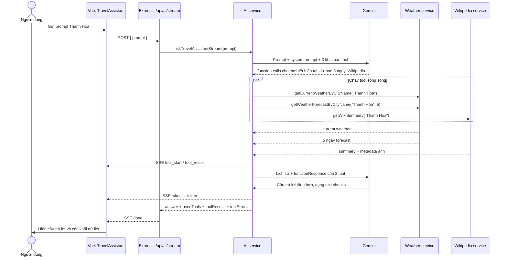

# Luồng hoạt động của AI Service: ví dụ Thanh Hóa

Tài liệu này lần theo một câu hỏi cụ thể qua frontend, backend, Gemini và các dịch vụ dữ liệu:

> **Prompt:** “Thời tiết hiện tại và 5 ngày tới ở Thanh Hóa kèm giới thiệu về Thanh Hóa”

Ví dụ tập trung vào ba tool mà câu hỏi cần: thời tiết hiện tại, dự báo 5 ngày và tóm tắt địa điểm. Gemini là thành phần quyết định tool nào cần gọi; ba lời gọi bên dưới mô tả luồng dự kiến hợp lý cho prompt này, không phải thứ tự cứng được backend ép buộc.

## 1. Nhìn toàn cảnh



Ở mức ngắn gọn, luồng là:

1. Frontend gửi prompt.
2. Gemini đọc yêu cầu và đề xuất gọi ba tool.
3. Backend thực thi các tool, lấy dữ liệu thật.
4. Backend đưa kết quả tool trở lại Gemini để tổng hợp.
5. Frontend nhận stream và hiển thị văn bản cùng dữ liệu tool.

## 2. Frontend gửi câu hỏi

Ở chế độ Trợ lý, component `client/src/components/TravelAssistant.vue` gọi:

```http
POST /api/ai/stream
Content-Type: application/json

{
  "prompt": "Thời tiết hiện tại và 5 ngày tới ở Thanh Hóa kèm giới thiệu về Thanh Hóa"
}
```

Frontend bật trạng thái đang xử lý, xóa dữ liệu của lượt trước và đọc response như một luồng SSE. Đây là `fetch()` POST, không phải `EventSource`, vì prompt được gửi trong JSON body.

API được mount qua `server/src/app.js` và `server/src/routes/index.js`; route `/api/ai/stream` nằm trong `server/src/routes/ai.js`. Route kiểm tra prompt trước. Nếu prompt rỗng, server trả HTTP 400 JSON; nếu hợp lệ, server mở response `text/event-stream` và gửi event trạng thái ban đầu.

## 3. AI service chuẩn bị hội thoại và tool

Trong `server/src/services/ai.js`, service tạo lịch sử ban đầu về cơ bản như sau:

```js
const contents = [
  { role: 'user', parts: [{ text: prompt }] },
];
```

Service gửi nội dung này tới Gemini cùng:

- System prompt yêu cầu trả lời tiếng Việt, không bịa dữ liệu.
- Quy tắc chỉ gọi tool thời tiết khi câu hỏi thật sự hỏi thời tiết/dự báo.
- Quy tắc dùng Wikipedia khi cần giới thiệu địa điểm.
- Khai báo schema cho các tool có thể sử dụng.

Prompt này nói rõ cả thời tiết hiện tại, dự báo 5 ngày và giới thiệu Thanh Hóa, nên ba tool phù hợp là:

| Tool | Arguments Gemini cần cung cấp | Dữ liệu cần lấy |
| --- | --- | --- |
| `getCurrentWeatherByCityName` | `{ "cityName": "Thanh Hóa" }` | Thời tiết hiện tại. |
| `getWeatherForecastByCityName` | `{ "cityName": "Thanh Hóa", "days": 5 }` | Dự báo 5 ngày. |
| `getWikiSummary` | `{ "title": "Thanh Hóa" }` | Thông tin tóm tắt về địa điểm. |

Tên thành phố và arguments ở trên là ví dụ. Gemini có thể chuẩn hóa cách viết hoặc chọn cách gọi khác; backend không tự suy ra cố định ba lời gọi này từ prompt.

## 4. Ba tool làm gì?

### 4.1 Thời tiết hiện tại

`getCurrentWeatherByCityName("Thanh Hóa")` trong `server/src/services/weather.js`:

1. Tìm tọa độ theo tên địa điểm qua geo service.
2. Lấy dữ liệu thời tiết hiện tại.
3. Chọn các trường cần thiết và trả về một object gọn cho giao diện.

Ví dụ hình dạng kết quả:

```json
{
  "cityName": "Thanh Hóa",
  "temperature": 29,
  "condition": "...",
  "meme": "...",
  "icon": "...",
  "humidity": 70,
  "windSpeed": 8,
  "precipitation": 0
}
```

Các số và mô tả trên chỉ minh họa cấu trúc, không phải dự báo thực tế. Frontend dùng dữ liệu này để dựng thẻ **Hiện tại**.

### 4.2 Dự báo 5 ngày

`getWeatherForecastByCityName("Thanh Hóa", 5)` cũng tìm tọa độ, sau đó yêu cầu dữ liệu forecast với `forecast_days: 5`. Weather service giới hạn số ngày trong khoảng 1 đến 7; số 5 được giữ nguyên.

Kết quả có dạng:

```json
{
  "cityName": "Thanh Hóa",
  "days": [
    {
      "date": "YYYY-MM-DD",
      "tempMax": 32,
      "tempMin": 25,
      "description": "...",
      "icon": "..."
    }
  ]
}
```

Mảng ví dụ được rút gọn; kết quả thực tế có tối đa 5 phần tử cho yêu cầu này. Frontend hiển thị từng ngày trong thẻ **Dự báo**.

### 4.3 Giới thiệu địa điểm

`getWikiSummary("Thanh Hóa")` gọi Wikipedia service và có thể trả về:

```json
{
  "title": "Thanh Hóa",
  "summary": "Phần tóm tắt về địa điểm...",
  "thumbnail": {
    "source": "https://...",
    "width": 300,
    "height": 200
  }
}
```

Thumbnail có thể không tồn tại. Backend giữ cả object này trong `toolResults` để frontend có thể hiện ảnh và nguồn. Khi gửi phản hồi tool về cho Gemini, `toModelResponse` chỉ gửi `summary`, không gửi metadata thumbnail.

## 5. Vì sao ba tool có thể chạy đồng thời?

Gemini trả về function calls trong một lượt model. Service đưa danh sách calls vào `Promise.all()`, nên cả ba tool có thể được bắt đầu gần như cùng lúc. Không cần chờ Wikipedia xong mới bắt đầu thời tiết, hoặc ngược lại.

Trong stream, backend phát `tool_start` cho từng tool rồi phát `tool_result` khi từng lời gọi hoàn tất. Do thời gian truy cập dịch vụ khác nhau, kết quả có thể về theo thứ tự khác với thứ tự prompt hoặc bảng trên. Thứ tự event không biểu thị mức độ quan trọng.

Weather service có cache RAM TTL 5 phút theo tọa độ và số ngày forecast. Tool hiện tại và dự báo 5 ngày có tham số số ngày khác nhau, vì vậy dùng khóa cache khác nhau. Geocoding có thể được tái sử dụng theo cơ chế riêng của geo service.

## 6. Gửi kết quả tool trở lại Gemini

Sau khi chạy tool, service lưu kết quả gốc để trả về frontend, đồng thời thêm phản hồi function vào lịch sử hội thoại. Minh họa rút gọn:

```js
contents.push({
  role: 'model',
  parts: [
    { functionCall: { name: 'getCurrentWeatherByCityName', args: { cityName: 'Thanh Hóa' } } },
    { functionCall: { name: 'getWeatherForecastByCityName', args: { cityName: 'Thanh Hóa', days: 5 } } },
    { functionCall: { name: 'getWikiSummary', args: { title: 'Thanh Hóa' } } },
  ],
});

contents.push({
  role: 'user',
  parts: [
    { functionResponse: { name: 'getCurrentWeatherByCityName', response: { result: currentWeather } } },
    { functionResponse: { name: 'getWeatherForecastByCityName', response: { result: forecast } } },
    { functionResponse: { name: 'getWikiSummary', response: { result: wikiSummaryText } } },
  ],
});
```

Đây là ví dụ giải thích cấu trúc; code thực tế tạo các phần tử dựa trên calls Gemini trả về. Sau đó service gọi Gemini thêm một lượt, lần này Gemini có đủ dữ liệu để viết phần giới thiệu và kết luận. Vì system prompt yêu cầu thời tiết hiển thị riêng, câu trả lời chữ không nên lặp lại chi tiết nhiệt độ/dự báo đã nằm trong thẻ thời tiết.

Với trường hợp bình thường, có thể hình dung **hai lượt Gemini**: lượt đầu yêu cầu tool, lượt sau tổng hợp. Nếu model yêu cầu thêm tool, service có thể lặp tiếp; giới hạn hiện tại là tối đa bốn vòng có tool rồi một lượt tổng hợp cuối.

### 6.1 Chính xác thì backend gọi API Gemini ra sao?

Ở mỗi lượt, `streamModelTurn()` gọi SDK `@google/genai` bằng `models.generateContentStream()`. Những đầu vào chính là:

- `model`: giá trị `GEMINI_MODEL`, mặc định `gemini-3-flash-preview`.
- `contents`: toàn bộ lịch sử hội thoại tích lũy đến thời điểm đó, không chỉ prompt gần nhất.
- `config.systemInstruction`: quy tắc hành xử của trợ lý.
- `config.temperature`: `0.2`.
- `config.tools`: khai báo function tools ở các step 0–3; không khai báo ở step 4.
- `config.abortSignal`: cho phép route yêu cầu SDK dừng nếu kết nối stream bị đóng.

Gemini trả về một stream gồm nhiều chunk. Service không gọi tool ngay khi thấy một mảnh `functionCall`: arguments có thể được chia giữa các chunk. `streamModelTurn()` gom các phần có cùng ID (hoặc cùng tên và vị trí part), ghép arguments lại, rồi chỉ trả danh sách calls sau khi stream của lượt Gemini kết thúc. Sau đó `chatWithTools()` mới thực thi các calls.

Nếu chunk có text, service phát `token` ngay để giao diện có thể hiện chữ sớm. Nếu một lượt vừa có text vừa có function call, sau khi nhận đủ lượt service phát `reset` trước khi chạy tool; phần text trung gian đó không bị trộn vào câu trả lời tổng hợp cuối.

### 6.2 Vòng lặp `step` và ý nghĩa riêng của `step = 4`

Code có hai điều kiện cần đọc cùng nhau:

```js
for (let step = 0; step <= MAX_STEPS; step++) {
  // ...gọi Gemini...
  if (calls.length === 0) return result;
  if (step === MAX_STEPS) throw new Error('Model tiếp tục yêu cầu tool sau giới hạn');
  // ...chạy tools rồi thêm functionResponse vào contents...
}
```

Với `MAX_STEPS = 4`, vòng lặp có thể gọi Gemini tại các giá trị `step` từ 0 đến 4. Nhưng cấu hình tool là `step < MAX_STEPS`, nên step 4 **không có khai báo tool**. Do đó:

- Tối đa có **5 request/lượt sinh nội dung tới Gemini**: step 0, 1, 2, 3 và 4.
- Tối đa có **4 đợt thực thi tool**: calls nhận ở step 0, 1, 2 hoặc 3.
- Mỗi đợt có thể gồm nhiều tool chạy song song; giới hạn bốn đợt không phải giới hạn bốn tool đơn lẻ.
- Thông thường service dừng sớm ngay khi Gemini trả text mà không có function call. Không phải request nào cũng đi đến step 4.

| Step | Đây là request Gemini thứ | Có khai báo tools? | Nếu Gemini trả function calls |
| ---: | ---: | --- | --- |
| 0 | 1 | Có | Thực thi đợt tool thứ nhất, rồi thêm phản hồi vào lịch sử. |
| 1 | 2 | Có | Nếu còn cần dữ liệu, thực thi đợt tool thứ hai. Nếu không có calls, trả câu trả lời và dừng. |
| 2 | 3 | Có | Có thể thực thi đợt tool thứ ba. |
| 3 | 4 | Có | Đây là đợt cuối được phép thực thi tool; sau đó chuyển sang step 4. |
| 4 | 5 | Không | Nếu không có calls, đây là câu trả lời cuối. Nếu vẫn có calls, service ném lỗi vượt giới hạn và trả fallback. |

Luồng prompt Thanh Hóa nếu Gemini yêu cầu cả ba tool cùng lượt sẽ là:

```text
step 0: gửi prompt + khai báo tools
        Gemini yêu cầu 3 function calls
        backend chạy 3 tool song song, thu dữ liệu

step 1: gửi lịch sử gồm prompt, function calls của Gemini,
        và 3 functionResponse vừa lấy được
        Gemini trả câu trả lời dạng text chunks, không yêu cầu tool
        service kết thúc; step 2, 3, 4 không chạy
```

Ở ví dụ này, ba tool là **ba function calls trong một đợt**, không phải ba step. Thường chỉ cần hai lượt Gemini: lượt đầu chọn/call tools và lượt kế tiếp tổng hợp.

Nếu model cứ yêu cầu thêm dữ liệu ở nhiều lượt, contents được nối dần theo dạng:

```text
prompt ban đầu
→ model functionCall ở step 0
→ user functionResponse của step 0
→ model functionCall ở step 1 (nếu có)
→ user functionResponse của step 1
→ ...
→ request tổng hợp tại step 4, không khai báo tools
```

Tại step 4, Gemini được yêu cầu dựa trên prompt và toàn bộ lịch sử/function responses đã tích lũy để trả lời bằng text, không được cấp tool declarations trong request đó. Nếu response vẫn chứa function calls, nhánh kiểm tra `step === MAX_STEPS` ném lỗi thay vì thực thi thêm tool. `askTravelAssistantStream()` bắt lỗi này, phát event `error` và trả câu trả lời fallback.

Lưu ý theo đúng hành vi hiện tại: nhánh fallback tổng thể tạo kết quả mới với `usedTools`, `toolResults` và `toolErrors` rỗng. Nếu stream đã phát các event `tool_result` ở step trước, frontend từng nhận chúng; nhưng event `done` của fallback lại mang các mảng rỗng và có thể thay thế dữ liệu đang hiển thị. Điều này áp dụng cho lỗi tổng thể như vượt giới hạn, khác với lỗi riêng một tool vốn được ghi vào `toolErrors` để model còn có thể tiếp tục.

## 7. Frontend nhận kết quả và dựng giao diện

Vì endpoint đang dùng SSE, các dữ liệu đến frontend theo các event. Ví dụ giản lược:

```text
event: tool_start
data: {"type":"tool_start","tool":"getWeatherForecastByCityName","args":{"cityName":"Thanh Hóa","days":5}}

event: tool_result
data: {"type":"tool_result","result":{"tool":"getWeatherForecastByCityName","args":{"cityName":"Thanh Hóa","days":5},"data":{"cityName":"Thanh Hóa","days":[...]}}}

event: token
data: {"type":"token","text":"Thanh Hóa là..."}

event: done
data: {"answer":"Thanh Hóa là...","usedTools":[...],"toolResults":[...],"toolErrors":[]}
```

`TravelAssistant.vue` đọc stream bằng `ReadableStream` và `TextDecoder`, gom byte thành frame hoàn chỉnh rồi chuyển từng event thành cập nhật state:

- `tool_start`: cập nhật trạng thái, ví dụ đang lấy dự báo.
- `tool_result`: thêm dữ liệu vào `toolResults`; dữ liệu thời tiết/Wikipedia có thể xuất hiện trước khi câu trả lời kết thúc.
- `token`: nối thêm một phần câu trả lời vào giao diện.
- `done`: đồng bộ danh sách tool đã dùng, dữ liệu cuối và báo hoàn tất.

Câu trả lời Markdown được sanitize trước khi đưa vào DOM. Các thẻ thời tiết và phần Wikipedia được dựng từ `toolResults`, không cần đọc ngược dữ liệu từ câu trả lời văn bản.

## 8. Response cuối cùng trông như thế nào?

Kết quả nghiệp vụ mà AI service trả cho route có dạng tổng quát:

```json
{
  "answer": "Phần giới thiệu/tổng hợp về Thanh Hóa...",
  "usedTools": [
    "getCurrentWeatherByCityName",
    "getWeatherForecastByCityName",
    "getWikiSummary"
  ],
  "toolResults": [
    { "tool": "getCurrentWeatherByCityName", "args": { "cityName": "Thanh Hóa" }, "data": {} },
    { "tool": "getWeatherForecastByCityName", "args": { "cityName": "Thanh Hóa", "days": 5 }, "data": { "days": [] } },
    { "tool": "getWikiSummary", "args": { "title": "Thanh Hóa" }, "data": { "summary": "...", "thumbnail": null } }
  ],
  "toolErrors": []
}
```

Trong stream, object này được gửi trong event `done`; các event status, tool và token đã được gửi trước đó. Endpoint JSON không stream `/api/ai` trả kết quả cuối theo JSON và dùng cache kết quả prompt trong 5 phút. Endpoint `/api/ai/stream` không dùng cache kết quả prompt để có thể phát tiến độ trực tiếp.

## 9. Nếu có lỗi thì sao?

- Nếu thiếu API key hoặc Gemini lỗi, service phát event `error` trong stream và trả câu trả lời fallback; route sau đó vẫn phát `done` nếu kết nối còn mở.
- Nếu một tool ném lỗi, service phát `tool_error`, ghi nhận trong `toolErrors`, rồi vẫn gửi phản hồi lỗi tool về Gemini để model có thể trả lời phần còn lại.
- Nếu geo service không tìm được tọa độ, weather service có thể trả `null` thay vì ném exception. Khi đó có thể thấy một `tool_result` không có dữ liệu thời tiết usable, thay vì `tool_error`.
- Nếu frontend đóng kết nối, route phát hiện response đóng và gửi tín hiệu abort tới Gemini. Việc hủy là best effort.

## 10. Điều cần nhớ về “gọi 3 tool”

Với prompt này, ba tool trên là lựa chọn phù hợp và đó là kịch bản tài liệu đang mô tả. Tuy nhiên, Gemini mới là bên phát function calls; backend cung cấp tool và thực thi đúng các calls nhận được, chứ không hard-code rằng mỗi câu hỏi Thanh Hóa luôn gọi đủ ba tool.

Nếu Gemini yêu cầu cả ba trong cùng lượt, backend chạy song song và thường quay lại Gemini thêm một lượt để tổng hợp. Frontend nhận dữ liệu thời tiết và Wikipedia để render riêng, đồng thời nhận câu trả lời chữ qua các token stream. Đó là toàn bộ hành trình từ prompt đến kết quả người dùng nhìn thấy.