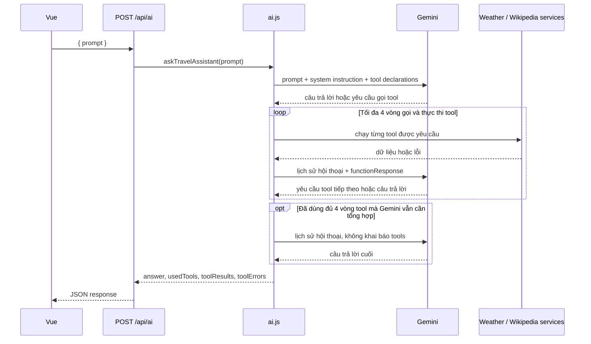

# AI Travel Assistant Service

Tài liệu này giải thích service trợ lý du lịch trong `src/services/ai.js`: Gemini nhận yêu cầu như thế nào, khi nào gọi tool, dữ liệu tool được gửi lại ra sao, và API trả kết quả gì cho Vue.

## 1. Service làm gì?

Service nhận một câu hỏi tự nhiên, ví dụ:

> Dự báo thời tiết 3 ngày ở Hà Nội và giới thiệu về Hà Nội.

Gemini quyết định cần lấy dữ liệu nào. Nếu cần, service gọi các hàm nội bộ để lấy thời tiết hoặc tóm tắt Wikipedia. Sau đó service gửi dữ liệu đó lại cho Gemini để tạo câu trả lời cuối cùng.

Các tool hiện có:

| Tool | Dùng để lấy | Tham số chính |
| --- | --- | --- |
| `getCurrentWeatherByCityName` | Thời tiết hiện tại | `cityName` |
| `getWeatherForecastByCityName` | Dự báo thời tiết | `cityName`, `days` tùy chọn |
| `getWikiSummary` | Tóm tắt Wikipedia về địa điểm | `title` |

Service không để Gemini tự đoán dữ liệu thời tiết. Dữ liệu thời tiết phải đến từ weather service. Phần giao diện có thể dùng `toolResults` để hiển thị thành thẻ thời tiết và thẻ dự báo.

## 2. Cấu hình

Server cần có `GEMINI_API_KEY` trong `server/.env`:

```env
GEMINI_API_KEY=your_gemini_api_key
```

Có thể chọn model bằng biến tùy chọn:

```env
GEMINI_MODEL=gemini-3-flash-preview
```

Nếu không khai báo `GEMINI_MODEL`, service dùng `gemini-3-flash-preview`. Sau khi sửa `.env`, cần khởi động lại server để biến môi trường được nạp lại.

Gemini client được khởi tạo lần đầu khi service cần gọi Gemini. Nếu thiếu API key, service ném lỗi nội bộ; `askTravelAssistant` bắt lỗi đó và trả về câu trả lời dự phòng.

## 3. Luồng xử lý tổng quan



### Các bước chi tiết

1. Route nhận `prompt`, trim khoảng trắng và từ chối prompt rỗng bằng HTTP `400`.
2. `askTravelAssistant` kiểm tra prompt, sau đó dùng cache theo prompt đã lowercase trong 5 phút.
3. `chatWithTools` gửi prompt đến Gemini cùng `SYSTEM_PROMPT` và khai báo ba tool.
4. Nếu Gemini trả câu trả lời văn bản mà không yêu cầu tool, service trả lời ngay.
5. Nếu Gemini yêu cầu một hoặc nhiều tool, service thực thi chúng song song.
6. Kết quả từng tool được thêm vào hội thoại dưới dạng `functionResponse`.
7. Service gửi toàn bộ lịch sử hội thoại trở lại Gemini để Gemini tổng hợp hoặc yêu cầu tool tiếp.
8. Sau tối đa bốn vòng thực thi tool, service gửi thêm một lượt tổng hợp không kèm khai báo tools.

`step` bắt đầu từ 0, nên `MAX_STEPS = 4` **không có nghĩa là chỉ gọi Gemini 4 lần**. Vòng lặp có tối đa 5 lượt gọi Gemini, được đánh số 0–4:

| Giá trị `step` | Lượt gọi Gemini | Có khai báo tools? | Nếu Gemini yêu cầu tool |
| --- | ---: | --- | --- |
| 0 | 1 | Có | Thực thi vòng tool thứ 1 |
| 1 | 2 | Có | Thực thi vòng tool thứ 2 |
| 2 | 3 | Có | Thực thi vòng tool thứ 3 |
| 3 | 4 | Có | Thực thi vòng tool thứ 4 |
| 4 | 5 | Không | Không thể gọi thêm tool; yêu cầu tool lúc này bị xem là vượt giới hạn |

Một **vòng tool** gồm một phản hồi Gemini yêu cầu tool và việc service thực thi các tool trong phản hồi đó. Gemini có thể yêu cầu nhiều tool trong cùng một vòng; các tool đó chạy song song. Vì vậy “tối đa 4 vòng tool” không đồng nghĩa “tối đa 4 tool đơn lẻ”.

Service dừng sớm ngay khi Gemini trả văn bản và không yêu cầu tool. Ví dụ thường gặp: lượt gọi Gemini thứ nhất yêu cầu dự báo và Wikipedia; service chạy cả hai tool song song; lượt gọi thứ hai nhận kết quả và trả lời bằng văn bản. Khi đó chỉ dùng một vòng tool và hai lượt gọi Gemini. Lượt thứ năm chỉ xảy ra nếu cả bốn vòng trước đều tiếp tục yêu cầu tool.

## 4. Ví dụ thực tế: dự báo 3 ngày và giới thiệu Hà Nội

Vue gửi request:

```http
POST /api/ai
Content-Type: application/json
```

```json
{
  "prompt": "Dự báo thời tiết 3 ngày ở Hà Nội và giới thiệu về Hà Nội"
}
```

### Lượt đầu gửi Gemini

Gemini nhận prompt ban đầu, `SYSTEM_PROMPT`, model và khai báo các function mà nó được phép yêu cầu. Trong đó có mô tả tham số của từng tool. Gemini có thể quyết định yêu cầu hai tool:

```json
[
  {
    "name": "getWeatherForecastByCityName",
    "args": { "cityName": "Hà Nội", "days": 3 }
  },
  {
    "name": "getWikiSummary",
    "args": { "title": "Hà Nội" }
  }
]
```

Đây là ví dụ minh họa quyết định của model; số lượng và thứ tự tool thực tế do Gemini chọn.

### Service thực thi tool

Tool dự báo gọi `getWeatherForecastByCityName('Hà Nội', 3)`. Tool Wikipedia gọi `getWikiSummary('Hà Nội')`. Hai tool trong cùng một lượt được chạy song song.

Dữ liệu dự báo có dạng:

```json
{
  "cityName": "Hà Nội",
  "days": [
    {
      "date": "2026-10-03",
      "tempMax": 31,
      "tempMin": 25,
      "description": "Mưa nhẹ",
      "icon": "bi bi-cloud-rain"
    }
  ]
}
```

`days` trong ví dụ được rút gọn còn một phần tử để dễ đọc; request ba ngày sẽ yêu cầu ba ngày dự báo nếu API nguồn trả đủ dữ liệu. `icon` là class Bootstrap Icons tra theo weather code, dùng trực tiếp ở giao diện.

Tool Wikipedia trả về một chuỗi tóm tắt, ví dụ:

```text
Hà Nội là thủ đô của Việt Nam...
```

### Gửi kết quả tool lại cho Gemini

Service giữ nguyên prompt ban đầu và phản hồi trước đó của Gemini, rồi thêm kết quả tool thành các `functionResponse`:

```js
contents.push({
  role: 'user',
  parts: [
    {
      functionResponse: {
        name: 'getWeatherForecastByCityName',
        response: { result: forecastData },
      },
    },
    {
      functionResponse: {
        name: 'getWikiSummary',
        response: { result: wikiSummary },
      },
    },
  ],
});
```

Ở lần gọi Gemini tiếp theo, service gửi **toàn bộ `contents`**: prompt ban đầu, các phản hồi function-call của Gemini, và kết quả tool. Vì thế Gemini có đủ ngữ cảnh để viết câu trả lời cuối.

Nếu các vòng tool kết thúc trước giới hạn, Gemini có thể vừa tổng hợp vừa được quyền yêu cầu tool tiếp. Nếu đã dùng đủ bốn vòng, lượt cuối không khai báo `tools`, nên Gemini chỉ có thể tổng hợp từ dữ liệu đã nhận.

## 5. Số ngày dự báo

Các giới hạn và mặc định được định nghĩa tập trung trong `src/services/weather.js`:

- Tối thiểu: `MIN_FORECAST_DAYS` = 1.
- Tối đa: `MAX_FORECAST_DAYS` = 7.
- Mặc định: `DEFAULT_FORECAST_DAYS` = 7.

AI tool dùng cùng các hằng số này. Nếu model truyền `days`, service chuyển giá trị đó cho weather service; weather service chuẩn hóa và giới hạn giá trị trong khoảng 1–7. Nếu không truyền, dự báo mặc định 7 ngày.

Ví dụ:

| Tham số tool | Kết quả dự kiến |
| --- | --- |
| `{ cityName: "Hà Nội" }` | 7 ngày |
| `{ cityName: "Hà Nội", days: 3 }` | 3 ngày |
| `{ cityName: "Hà Nội", days: 20 }` | Giới hạn còn 7 ngày |
| `{ cityName: "Hà Nội", days: 0 }` | Dùng mặc định 7 ngày |

Tool schema chỉ mô tả cho Gemini cách gọi tool; việc chuẩn hóa thật sự được weather service thực hiện.

## 6. API và response

Route được mount ở `/api/ai`, nên endpoint đầy đủ là `POST /api/ai`.

Prompt thiếu hoặc chỉ có khoảng trắng trả về HTTP `400`:

```json
{ "error": "Thiếu prompt" }
```

Khi service xử lý được request, response có cấu trúc:

```json
{
  "answer": "Dự báo cho Hà Nội có mưa nhẹ. Hà Nội là thủ đô của Việt Nam...",
  "usedTools": [
    "getWeatherForecastByCityName",
    "getWikiSummary"
  ],
  "toolResults": [
    {
      "tool": "getWeatherForecastByCityName",
      "args": { "cityName": "Hà Nội", "days": 3 },
      "data": {
        "cityName": "Hà Nội",
        "days": []
      }
    },
    {
      "tool": "getWikiSummary",
      "args": { "title": "Hà Nội" },
      "data": "Tóm tắt Wikipedia..."
    }
  ],
  "toolErrors": []
}
```

Các giá trị trong ví dụ là minh họa. Trong response thật, `days` chứa dữ liệu dự báo nhận được từ Open-Meteo.

- `answer`: phần Gemini tổng hợp để hiển thị cho người dùng.
- `usedTools`: tên các tool chạy thành công.
- `toolResults`: dữ liệu thô theo từng tool; Vue dùng trường này để dựng thẻ thời tiết/dự báo.
- `toolErrors`: lỗi riêng của từng tool. Lỗi một tool không nhất thiết làm mất kết quả từ tool khác.

Nếu Gemini thiếu key, hết quota, lỗi mạng, vượt giới hạn tool hoặc không tạo được câu trả lời, `askTravelAssistant` ghi log và trả câu fallback với các mảng rỗng. Trường hợp này hiện vẫn được route trả bằng HTTP `200`; xem `src/routes/ai.js` và `src/services/ai.js`.

### Streaming response cho Vue

Endpoint streaming trả tiến trình xử lý, kết quả tool và từng phần văn bản Gemini tạo ra. Dùng endpoint SSE riêng:

```http
POST /api/ai/stream
Content-Type: application/json
```

```json
{ "prompt": "Dự báo thời tiết 3 ngày ở Hà Nội" }
```

Response giữ kết nối HTTP mở và gửi các frame theo định dạng `text/event-stream`. Mỗi frame có tên event và một dòng JSON:

```text
event: status
data: {"type":"status","message":"Đang phân tích yêu cầu..."}

event: token
data: {"type":"token","text":"Dự báo cho Hà Nội"}

event: done
data: {"answer":"Dự báo cho Hà Nội...","usedTools":[],"toolResults":[],"toolErrors":[]}
```

#### Cách đọc tiến trình

Luồng hoạt động theo thứ tự sau:

1. Route kiểm tra `prompt`. Prompt rỗng nhận HTTP `400` JSON và không mở luồng SSE.
2. Với prompt hợp lệ, route mở response `text/event-stream` và gửi `status` với thông báo `Đã nhận yêu cầu, đang kết nối với trợ lý...`.
3. Service bắt đầu một lượt gọi Gemini và gửi `status` là `Đang phân tích yêu cầu...`. Đây là nhãn do ứng dụng đặt trước khi chờ Gemini trả kết quả; nó không phải phần trăm tiến độ hay trạng thái suy nghĩ nội bộ của Gemini.
4. Trong lúc Gemini trả nội dung, mỗi phần text nhận được được gửi thành một event `token`. Nếu Gemini yêu cầu tool, service gửi `tool_start`, chạy tool, rồi gửi `tool_result` hoặc `tool_error`.
5. Sau khi tool chạy xong, kết quả được gửi lại cho Gemini làm ngữ cảnh của lượt tiếp theo. Service lại phát `Đang phân tích yêu cầu...` trước lượt đó. Nhiều tool trong cùng lượt được chạy song song; vì vậy thứ tự các kết quả phụ thuộc tool nào hoàn tất trước.
6. Khi Gemini không yêu cầu tool nữa, service trả câu trả lời cuối. Route gửi một event `done` chứa câu trả lời cùng danh sách tool và đóng response.

Mỗi lượt trước giới hạn tool đều được gắn nhãn `Đang phân tích yêu cầu...`. Với `MAX_STEPS = 4`, lượt ở bước giới hạn được gắn `Đang tổng hợp câu trả lời...` và không khai báo tool cho Gemini. Đây vẫn là trạng thái do code quy định, không phải Gemini báo rằng nó đang ở một pha suy luận cụ thể. Vì thế giao diện không thể hiện chính xác Gemini còn bao lâu mới trả lời.

Event `status` khi bắt đầu request được phát từ `src/routes/ai.js`; các trạng thái từng lượt, tool và token được phát từ `src/services/ai.js`. Vue đọc từng frame từ `response.body` và cập nhật `statusMessage`; chấm tiến trình chỉ sáng theo cờ `loading` trong lúc request chưa kết thúc.

#### Ví dụ gọi thực tế

Có thể kiểm tra luồng từ terminal khi server đang chạy:

```bash
curl -N http://localhost:3000/api/ai/stream \
  -H "Content-Type: application/json" \
  -d '{"prompt":"Dự báo thời tiết 3 ngày ở Hà Nội và giới thiệu về Hà Nội"}'
```

Ví dụ dưới đây minh họa một lần Gemini chọn cả tool dự báo thời tiết lẫn Wikipedia. Nội dung text, đối số tool, dữ liệu trả về và thứ tự hoàn tất có thể khác theo câu hỏi, phản hồi dịch vụ bên ngoài và quyết định của Gemini:

```text
event: status
data: {"type":"status","message":"Đã nhận yêu cầu, đang kết nối với trợ lý..."}

event: status
data: {"type":"status","message":"Đang phân tích yêu cầu..."}

event: tool_start
data: {"type":"tool_start","tool":"getWeatherForecastByCityName","args":{"cityName":"Hà Nội","days":3}}

event: tool_start
data: {"type":"tool_start","tool":"getWikiSummary","args":{"title":"Hà Nội"}}

event: tool_result
data: {"type":"tool_result","result":{"tool":"getWeatherForecastByCityName","args":{"cityName":"Hà Nội","days":3},"data":{"cityName":"Hà Nội","days":[...]}}}

event: tool_result
data: {"type":"tool_result","result":{"tool":"getWikiSummary","args":{"title":"Hà Nội"},"data":{"title":"Hà Nội","extract":"..."}}}

event: status
data: {"type":"status","message":"Đang phân tích yêu cầu..."}

event: token
data: {"type":"token","text":"Hà Nội có "}

event: token
data: {"type":"token","text":"bề dày lịch sử..."}

event: done
data: {"answer":"Hà Nội có bề dày lịch sử...","usedTools":["getWeatherForecastByCityName","getWikiSummary"],"toolResults":[...],"toolErrors":[]}
```

Các dòng `data` ở trên là JSON. Mỗi event kết thúc bằng một dòng trống; client đọc `event:` làm tên loại sự kiện và parse JSON sau `data:`. `token` chỉ là một mảnh văn bản, không nhất thiết tương ứng một từ hay một câu; ghép các mảnh theo thứ tự để dựng câu trả lời. Payload `done` là kết quả cuối cùng, còn `tool_result` cho phép giao diện cập nhật dữ liệu tool ngay khi có.

Các event service có thể gửi:

| Event | Ý nghĩa | Dữ liệu chính |
| --- | --- | --- |
| `status` | Kết nối, đang phân tích, hoặc tới lượt tổng hợp theo giới hạn bước | `message` |
| `token` | Một phần text mới từ Gemini | `text` |
| `reset` | Xóa đoạn text tạm nếu lượt đó chuyển sang gọi tool | Không có |
| `tool_start` | Bắt đầu chạy tool | `tool`, `args` |
| `tool_result` | Tool trả dữ liệu; Vue có thể dựng thẻ ngay | `result` |
| `tool_error` | Một tool lỗi nhưng luồng vẫn có thể tiếp tục | `error` |
| `error` | Lỗi tổng quát, chẳng hạn Gemini không khả dụng; service hiện gửi event này rồi trả câu fallback | `message` |
| `done` | Kết thúc, kèm kết quả đầy đủ | `answer`, `usedTools`, `toolResults`, `toolErrors` |

Vì request cần gửi JSON bằng `POST`, Vue dùng `fetch()` và đọc `response.body` bằng `ReadableStream`; `EventSource` chuẩn chỉ hỗ trợ GET. Nếu Gemini lỗi sau khi mở stream, service gửi `error`, trả kết quả dự phòng, sau đó route vẫn gửi `done` và đóng luồng. Nếu trình duyệt đóng kết nối trước khi response kết thúc, route abort yêu cầu Gemini đang chạy.

Endpoint JSON `POST /api/ai` vẫn được giữ lại cho Thunder Client và client cũ.

## 7. Cache

Có nhiều lớp cache độc lập:

- Câu trả lời trợ lý: 5 phút, key là `travel:` cộng prompt đã lowercase.
- Dữ liệu thời tiết: 5 phút, key dựa trên tọa độ và số ngày dự báo.
- Tóm tắt Wikipedia: 10 phút, key dựa trên loại nội dung và từ khóa.

Endpoint JSON `POST /api/ai` cache câu trả lời trợ lý trong 5 phút. Endpoint streaming không cache câu trả lời hoàn chỉnh để mỗi request có thể phát tiến trình và token mới; các cache thời tiết và Wikipedia vẫn được dùng. Cache là RAM của tiến trình; restart server sẽ xóa cache.

## 8. Gọi service từ code

```js
import { askTravelAssistant } from './services/ai.js';

const result = await askTravelAssistant(
  'Thời tiết hiện tại ở Đà Nẵng và giới thiệu ngắn về thành phố'
);

console.log(result.answer);
console.log(result.usedTools);
console.log(result.toolResults);
```

Hàm `askGemini(prompt, systemInstruction?)` cũng được export để gọi Gemini một lần ở chế độ văn bản, không dùng tool. Prompt rỗng sẽ bị từ chối.

## 9. Chạy kiểm tra

Từ thư mục gốc:

```bash
npm test --prefix server
```

Một số test thời tiết/Wikipedia gọi API ngoài, nên kết quả có thể phụ thuộc kết nối mạng và dữ liệu API.
