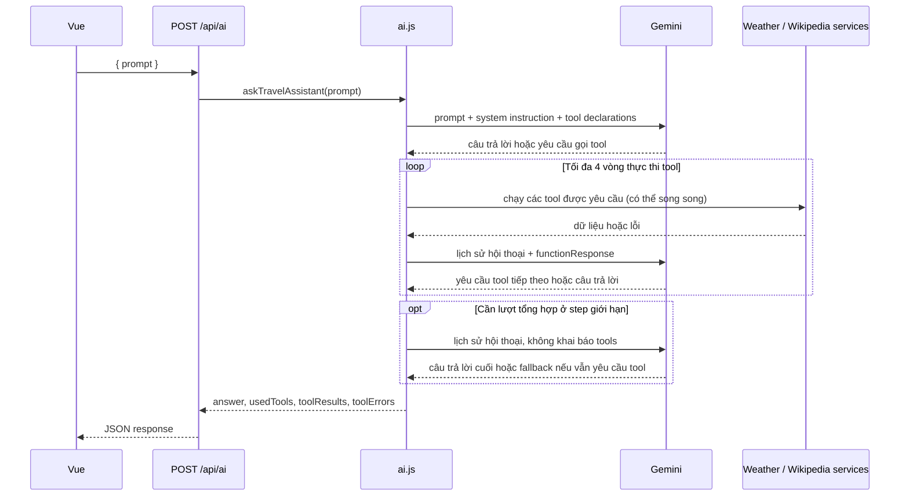

# AI Travel Assistant Service

Tài liệu này mô tả hệ thống AI hiện tại trong `server/src/services/ai.js` và route `server/src/routes/ai.js`. Đây là luồng tool-calling thực tế của dự án, không phải mô hình nền tảng cũ.

## 1. Mục tiêu của service

Service nhận một prompt tiếng Việt như:

> Dự báo thời tiết 3 ngày ở Hà Nội và giới thiệu về Hà Nội.

Sau đó:
- gửi prompt lên Gemini
- quyết định có cần tool hay không
- nếu cần, gọi các service nội bộ để lấy dữ liệu
- gửi kết quả tool lại cho Gemini để tổng hợp câu trả lời cuối
- trả dữ liệu về cho frontend ở dạng JSON hoặc SSE

## 2. Cấu hình hiện tại

Server cần biến môi trường `GEMINI_API_KEY` trong `server/.env`:

```env
GEMINI_API_KEY=your_gemini_api_key
```

Model mặc định nếu không khai báo `GEMINI_MODEL`:

```env
GEMINI_MODEL=gemini-3-flash-preview
```

Sau khi sửa `.env`, cần khởi động lại server để nạp lại biến môi trường.

Nếu thiếu API key, service sẽ log warning và trả fallback answer thay vì ném lỗi trực tiếp cho client. Route `/api/ai` vẫn trả `200` trong trường hợp này.

## 3. System prompt và chính sách tool

`SYSTEM_PROMPT` hiện tại quy định rõ ràng:
- chỉ gọi tool thời tiết khi người dùng hỏi rõ về thời tiết, dự báo, mưa, nhiệt độ, điều kiện thời tiết
- không gọi weather tool chỉ vì tên địa điểm xuất hiện trong câu hỏi
- khi cần thông tin về địa điểm, gọi `getWikiSummary`
- chỉ gọi những tool cần thiết
- không bịa dữ liệu
- nếu tool lỗi, vẫn trả lời phần có thể trả lời và nêu rõ phần thiếu

Điểm quan trọng: weather tool là opt-in theo ý định người dùng, không phải bắt buộc cho mọi câu hỏi có địa điểm.

## 4. Tool hiện có

Service khai báo 3 tool thực tế trong `TOOLS`:

| Tool | Mục đích | Tham số | Ghi chú |
| --- | --- | --- | --- |
| `getCurrentWeatherByCityName` | Lấy thời tiết hiện tại | `{ cityName: string }` | Gọi qua `getCurrentWeatherByCityName()` |
| `getWeatherForecastByCityName` | Lấy dự báo vài ngày | `{ cityName: string, days?: number }` | Dùng trong UI weather cards |
| `getWikiSummary` | Lấy tóm tắt địa điểm | `{ title: string }` | Trả về `{ title, summary, thumbnail }`, nhưng gửi lên model chỉ có `summary` |

### Quy tắc về Wikipedia

`getWikiSummary` không trả nguyên kiểu string cho model. Nó thực chất gọi `getWikiSummaryWithThumbnail(title)`, trả về đối tượng có dạng:

```json
{
  "title": "Hà Nội",
  "summary": "Hà Nội là thủ đô của Việt Nam...",
  "thumbnail": { "source": "https://...", "width": 300, "height": 200 }
}
```

Tuy nhiên, ở phần gửi lại cho Gemini, service dùng:

```js
toModelResponse: (result) => result?.summary ?? result
```

Nghĩa là model chỉ nhận `summary` text, còn metadata hình ảnh vẫn giữ lại trong `toolResults` cho frontend hiển thị.

## 5. Luồng xử lý thực tế



### 5.1 Request không streaming

Route mount ở `/api/ai`:

```http
POST /api/ai
Content-Type: application/json
```

Request mẫu:

```json
{
  "prompt": "Dự báo thời tiết 3 ngày ở Hà Nội và giới thiệu về Hà Nội"
}
```

Luồng xử lý:
1. Route kiểm tra prompt rỗng → HTTP 400 nếu thiếu.
2. Gọi `askTravelAssistant(prompt)`.
3. `askTravelAssistant` dùng cache theo prompt (TTL 5 phút) nếu hợp lệ.
4. `chatWithTools()` gửi prompt + `SYSTEM_PROMPT` + tool declarations cho Gemini.
5. Nếu Gemini không yêu cầu tool, trả lời ngay.
6. Nếu Gemini yêu cầu tool, service thực thi tool đó theo `Promise.all()` để chạy song song khi có nhiều tool.
7. Kết quả tool được gắn vào `functionResponse` và gửi lại cho Gemini.
8. Lặp lại tối đa `MAX_STEPS = 4` vòng tool.
9. Nếu vẫn tiếp tục yêu cầu tool sau giới hạn, service dừng và trả fallback.

Prompt thiếu hoặc chỉ có khoảng trắng nhận HTTP `400` và không gọi service:

```json
{ "error": "Thiếu prompt" }
```

`step` bắt đầu từ 0. Vì vòng lặp chạy với điều kiện `step <= MAX_STEPS`, `MAX_STEPS = 4` cho phép tối đa 5 lượt gọi Gemini, được đánh số từ 0 đến 4. Tools chỉ được khai báo khi `step < MAX_STEPS`, nên lượt ở `step = 4` là lượt tổng hợp cuối không có quyền gọi thêm tool.

| Giá trị `step` | Lượt gọi Gemini | Có khai báo tools? | Nếu Gemini yêu cầu tool |
| --- | ---: | --- | --- |
| 0 | 1 | Có | Thực thi vòng tool thứ 1 |
| 1 | 2 | Có | Thực thi vòng tool thứ 2 |
| 2 | 3 | Có | Thực thi vòng tool thứ 3 |
| 3 | 4 | Có | Thực thi vòng tool thứ 4 |
| 4 | 5 | Không | Không gọi tool thêm; yêu cầu tool ở lượt này sẽ dẫn đến fallback |

Một vòng tool gồm một lượt Gemini yêu cầu tool và việc service thực thi các tool được yêu cầu trong lượt đó. Gemini có thể yêu cầu nhiều tool cùng lúc; các tool này chạy song song bằng `Promise.all()`. Do đó, tối đa bốn vòng tool không có nghĩa là tối đa bốn tool đơn lẻ.

Service dừng sớm ngay khi Gemini trả lời bằng văn bản mà không yêu cầu tool. Ví dụ, Gemini có thể yêu cầu tool thời tiết và Wikipedia cùng lượt, service chạy cả hai song song, rồi Gemini trả lời ở lượt kế tiếp. Trường hợp đó dùng một vòng tool và hai lượt gọi Gemini; lượt thứ năm chỉ cần thiết nếu bốn vòng trước đều tiếp tục yêu cầu tool.

### Ví dụ một vòng gọi tool

Với prompt `Dự báo thời tiết 3 ngày ở Hà Nội và giới thiệu về Hà Nội`, Gemini có thể yêu cầu hai tool:

```json
[
  {
    "name": "getWeatherForecastByCityName",
    "args": { "cityName": "Hà Nội", "days": 3 }
  },
  {
    "name": "getWikiSummary",
    "args": { "title": "Hà Nội" }
  }
]
```

Đây là ví dụ minh họa; số lượng và thứ tự tool thực tế do Gemini chọn. Service giữ prompt và phản hồi trước đó của Gemini, sau đó thêm kết quả tool vào hội thoại dưới dạng `functionResponse`:

```js
contents.push({
  role: 'user',
  parts: [
    {
      functionResponse: {
        name: 'getWeatherForecastByCityName',
        response: { result: forecastData },
      },
    },
    {
      functionResponse: {
        name: 'getWikiSummary',
        response: { result: wikiSummary },
      },
    },
  ],
});
```

Ở lượt Gemini tiếp theo, service gửi toàn bộ `contents`, gồm prompt ban đầu, phản hồi function-call của Gemini và kết quả tool. Với Wikipedia, dữ liệu gốc trong `toolResults` có thể gồm `title`, `summary`, `thumbnail`, nhưng `functionResponse` gửi cho model chỉ chứa `summary`.

### 5.2 Request streaming

Route SSE mount ở `/api/ai/stream`:

```http
POST /api/ai/stream
Content-Type: application/json
```

Dòng sự kiện thực tế được route phát ra:
- `status`
- `tool_start`
- `tool_result`
- `tool_error`
- `token`
- `done`
- `error`

Ví dụ dạng event:

```text
event: status
data: {"message":"Đang phân tích yêu cầu..."}

event: tool_start
data: {"tool":"getWeatherForecastByCityName","args":{"cityName":"Hà Nội","days":3}}

event: tool_result
data: {"tool":"getWeatherForecastByCityName","args":{"cityName":"Hà Nội","days":3},"data":{"cityName":"Hà Nội","days":[...]}}

event: token
data: {"text":"Hà Nội là..."}

event: done
data: {"answer":"...","usedTools":[...],"toolResults":[...],"toolErrors":[]}
```

## 6. Response shape thực tế

Response JSON của `POST /api/ai` có dạng:

```json
{
  "answer": "Hà Nội có ...",
  "usedTools": ["getWeatherForecastByCityName", "getWikiSummary"],
  "toolResults": [
    {
      "tool": "getWeatherForecastByCityName",
      "args": { "cityName": "Hà Nội", "days": 3 },
      "data": {
        "cityName": "Hà Nội",
        "days": [
          {
            "date": "2026-10-13",
            "tempMax": 32,
            "tempMin": 26,
            "description": "Mưa nhẹ",
            "icon": "bi bi-cloud-rain"
          }
        ]
      }
    },
    {
      "tool": "getWikiSummary",
      "args": { "title": "Hà Nội" },
      "data": {
        "title": "Hà Nội",
        "summary": "Hà Nội là thủ đô của Việt Nam...",
        "thumbnail": null
      }
    }
  ],
  "toolErrors": []
}
```

### Ý nghĩa của từng trường

- `answer`: câu trả lời tổng hợp từ Gemini
- `usedTools`: danh sách tool chạy thành công
- `toolResults`: dữ liệu gốc của từng tool, dành cho frontend render
- `toolErrors`: lỗi của từng tool, nếu có

## 7. Dữ liệu thời tiết và giới hạn

Dự báo thời tiết ở `server/src/services/weather.js` có các hằng số:

- `MIN_FORECAST_DAYS = 1`
- `MAX_FORECAST_DAYS = 7`
- `DEFAULT_FORECAST_DAYS = 7`

`normalizeForecastDays()` đảm bảo:
- ngày 0 → dùng mặc định 7
- số âm → cắt về 1
- quá 7 → cắt về 7

Vì vậy tool `getWeatherForecastByCityName(cityName, days)` luôn được chuẩn hóa trong khoảng 1–7 trước khi gọi Open-Meteo.

| Tham số tool | Kết quả dự kiến |
| --- | --- |
| `{ cityName: "Hà Nội" }` | 7 ngày mặc định |
| `{ cityName: "Hà Nội", days: 3 }` | 3 ngày |
| `{ cityName: "Hà Nội", days: 20 }` | Giới hạn còn 7 ngày |
| `{ cityName: "Hà Nội", days: 0 }` | Dùng mặc định 7 ngày |

Tool schema mô tả cách Gemini có thể gọi tool; việc chuẩn hóa thực tế do weather service thực hiện.

## 8. Fallback và lỗi

Khi bất kỳ điều kiện nào sau đây xảy ra:
- thiếu `GEMINI_API_KEY`
- model trả lỗi
- quota / mạng / timeout
- Gemini tiếp tục yêu cầu tool quá số vòng cho phép
- model không trả văn bản

service sẽ log warning và trả:

```json
{
  "answer": "Mình chưa trả lời được ngay lúc này, bạn thử lại sau nhé.",
  "usedTools": [],
  "toolResults": [],
  "toolErrors": []
}
```

## 9. Khuyến nghị khi làm việc với service này

- Không giả định AI sẽ luôn sử dụng weather tool: nó chỉ gọi khi người dùng hỏi rõ ràng về thời tiết.
- Khi cần render dữ liệu trong UI, ưu tiên dùng `toolResults` thay vì chỉ đọc `answer`.
- Khi thêm tool mới, cần cập nhật cả:
  1. `TOOLS` object trong `ai.js`
  2. `FUNCTION_DECLARATIONS`
  3. `toModelResponse` nếu cần ép kiểu dữ liệu riêng cho model
  4. route/UX nếu muốn hiển thị thêm metadata trong giao diện

## 10. Kết luận

Service AI hiện tại của dự án là một layer tool-calling trung gian giữa Gemini và các service dữ liệu. Nó không chỉ trả lời văn bản, mà còn quản lý trạng thái, kết quả tool, và stream tiến độ cho Vue. Trên thực tế, luồng chính đang là:

Gemini → tool weather/wiki → dữ liệu thực → tổng hợp câu trả lời → return JSON hoặc SSE

Đây là nền tảng hoạt động của trang trợ lý du lịch và là điểm cần cập nhật nếu dự án mở rộng thêm tool mới hoặc thay đổi mô hình prompt.

## Ví dụ luồng hoạt động thực tế

```json
{ "prompt": "Dự báo thời tiết 3 ngày ở Hà Nội" }
```

Response giữ kết nối HTTP mở và gửi các frame theo định dạng `text/event-stream`. Mỗi frame có tên event và một dòng JSON:

```text
event: status
data: {"message":"Đã nhận yêu cầu, đang kết nối với trợ lý..."}

event: status
data: {"type":"status","message":"Đang phân tích yêu cầu..."}

event: tool_start
data: {"type":"tool_start","tool":"getWeatherForecastByCityName","args":{"cityName":"Hà Nội","days":3}}

event: tool_result
data: {"type":"tool_result","result":{"tool":"getWeatherForecastByCityName","args":{"cityName":"Hà Nội","days":3},"data":{"cityName":"Hà Nội","days":[...]}}}

event: token
data: {"type":"token","text":"Hà Nội có "}

event: token
data: {"type":"token","text":"mưa nhẹ trong 3 ngày tới."}

event: done
data: {"answer":"Hà Nội có mưa nhẹ trong 3 ngày tới.","usedTools":["getWeatherForecastByCityName"],"toolResults":[...],"toolErrors":[]}
```

### Cách đọc tiến trình

1. Route kiểm tra `prompt`. Prompt rỗng nhận HTTP `400` JSON và không mở luồng SSE.
2. Với prompt hợp lệ, route mở response `text/event-stream` và gửi `status` với thông báo `Đã nhận yêu cầu, đang kết nối với trợ lý...`.
3. Service gửi `status` là `Đang phân tích yêu cầu...` trước mỗi lượt Gemini có thể gọi tool. Đây là nhãn trạng thái do ứng dụng đặt, không phải phần trăm tiến độ hay trạng thái suy nghĩ nội bộ của Gemini.
4. Trong lúc Gemini trả nội dung, mỗi phần text nhận được được gửi thành một event `token`. Nếu lượt đó chuyển sang gọi tool sau khi đã có text tạm, service phát event `reset` để frontend xóa đoạn text đó.
5. Nếu Gemini yêu cầu tool, service gửi `tool_start`, chạy các tool song song, rồi gửi `tool_result` hoặc `tool_error`. Thứ tự kết quả phụ thuộc tool nào hoàn tất trước.
6. Sau khi tool chạy xong, kết quả được gửi lại cho Gemini làm ngữ cảnh của lượt tiếp theo. Ở bước giới hạn (`step = 4`), service phát `Đang tổng hợp câu trả lời...` và không khai báo tools.
7. Khi Gemini không yêu cầu tool nữa, service trả câu trả lời cuối. Route gửi một event `done` chứa câu trả lời cùng danh sách tool và đóng response.

Các thông báo trạng thái chỉ mô tả giai đoạn do code quy định; giao diện không thể hiện chính xác Gemini còn bao lâu mới trả lời. Event `status` đầu tiên được phát từ route, còn status từng lượt, tool, token và reset được phát từ service.

### Ví dụ gọi thực tế

Có thể kiểm tra luồng từ terminal khi server đang chạy:

```bash
curl -N http://localhost:3000/api/ai/stream \
  -H "Content-Type: application/json" \
  -d '{"prompt":"Dự báo thời tiết 3 ngày ở Hà Nội và giới thiệu về Hà Nội"}'
```

Ví dụ dưới đây minh họa một lần Gemini chọn cả tool dự báo thời tiết lẫn Wikipedia:

```text
event: status
data: {"message":"Đã nhận yêu cầu, đang kết nối với trợ lý..."}

event: status
data: {"type":"status","message":"Đang phân tích yêu cầu..."}

event: tool_start
data: {"type":"tool_start","tool":"getWeatherForecastByCityName","args":{"cityName":"Hà Nội","days":3}}

event: tool_start
data: {"type":"tool_start","tool":"getWikiSummary","args":{"title":"Hà Nội"}}

event: tool_result
data: {"type":"tool_result","result":{"tool":"getWeatherForecastByCityName","args":{"cityName":"Hà Nội","days":3},"data":{"cityName":"Hà Nội","days":[...]}}}

event: tool_result
data: {"type":"tool_result","result":{"tool":"getWikiSummary","args":{"title":"Hà Nội"},"data":{"title":"Hà Nội","summary":"...","thumbnail":null}}}

event: status
data: {"type":"status","message":"Đang phân tích yêu cầu..."}

event: token
data: {"type":"token","text":"Hà Nội có "}

event: token
data: {"type":"token","text":"bề dày lịch sử và văn hóa phong phú."}

event: done
data: {"answer":"Hà Nội có bề dày lịch sử...","usedTools":["getWeatherForecastByCityName","getWikiSummary"],"toolResults":[...],"toolErrors":[]}
```

Các event service có thể gửi:

| Event | Ý nghĩa | Dữ liệu chính |
| --- | --- | --- |
| `status` | Kết nối, đang phân tích, hoặc tới lượt tổng hợp | `message` |
| `token` | Một phần text mới từ Gemini | `text` |
| `reset` | Xóa đoạn text tạm nếu lượt đó chuyển sang gọi tool | Không có |
| `tool_start` | Bắt đầu chạy tool | `tool`, `args` |
| `tool_result` | Tool trả dữ liệu; UI có thể dựng thẻ ngay | `result` |
| `tool_error` | Một tool lỗi nhưng luồng vẫn có thể tiếp tục | `error` |
| `error` | Lỗi tổng quát | `message` |
| `done` | Kết thúc, kèm kết quả đầy đủ | `answer`, `usedTools`, `toolResults`, `toolErrors` |

Phần ví dụ này được giữ lại như tài liệu thực tiễn cho luồng hoạt động của service, dù nội dung tổng quan và response hiện đang được cập nhật theo code thật ở các mục trên.

Các dòng `data` là JSON và mỗi event kết thúc bằng một dòng trống. Client đọc `event:` làm tên loại sự kiện rồi parse JSON sau `data:`. `token` là một mảnh văn bản, không nhất thiết tương ứng một từ hay một câu; ghép các mảnh theo thứ tự. Payload `done` chứa kết quả cuối, còn `tool_result` cho phép giao diện cập nhật dữ liệu tool ngay khi có.

Vì request gửi JSON bằng `POST`, giao diện dùng `fetch()` và đọc `response.body` bằng `ReadableStream`; `EventSource` chuẩn chỉ hỗ trợ GET. Nếu Gemini lỗi sau khi mở stream, service gửi event `error`, trả câu fallback, sau đó route vẫn gửi `done` và đóng luồng. Nếu trình duyệt đóng kết nối trước khi response kết thúc, route abort yêu cầu Gemini đang chạy.

Endpoint JSON `POST /api/ai` vẫn được giữ lại cho các client không dùng streaming.

## Cache

Các cache lưu trong RAM của tiến trình và có thời hạn riêng:

- Câu trả lời trợ lý: 5 phút, key gồm `travel:` và prompt đã chuyển thành chữ thường.
- Dữ liệu thời tiết: 5 phút, key dựa trên tọa độ và số ngày dự báo.
- Tóm tắt Wikipedia: 10 phút, key dựa trên loại nội dung, tùy chọn thumbnail và từ khóa.

Endpoint JSON `POST /api/ai` cache câu trả lời trợ lý trong 5 phút. Endpoint streaming không cache câu trả lời hoàn chỉnh để mỗi request có thể phát tiến trình và token mới; cache thời tiết và Wikipedia vẫn được dùng. Khởi động lại server sẽ xóa các cache trong RAM.

## Gọi service từ code

```js
import { askTravelAssistant } from './services/ai.js';

const result = await askTravelAssistant(
  'Thời tiết hiện tại ở Đà Nẵng và giới thiệu ngắn về thành phố'
);

console.log(result.answer);
console.log(result.usedTools);
console.log(result.toolResults);
```

Hàm `askGemini(prompt, systemInstruction?)` cũng được export để gọi Gemini một lần ở chế độ văn bản, không dùng tool. Prompt rỗng sẽ bị từ chối.

## Chạy kiểm tra

Từ thư mục gốc:

```bash
npm test --prefix server
```

Một số test thời tiết/Wikipedia gọi API bên ngoài, nên kết quả có thể phụ thuộc kết nối mạng và dữ liệu API.
